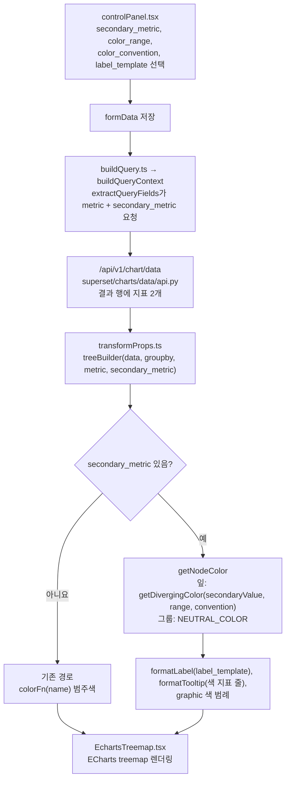
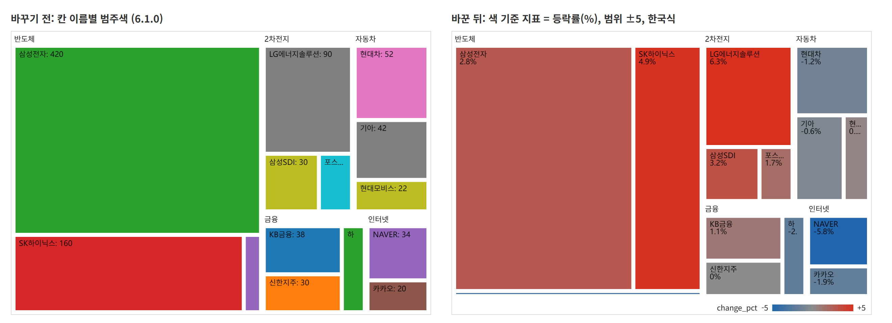

# 트리맵 색 기준 지표 (MVP 구현 정리)

- 담당: 황동호
- 브랜치: `feature/treemap-color` (`team9/main` 기준, Superset 6.1.0)
- 범위: 중간보고서 4장 1)에 적은 **기본 1~4**. 확장 1~3(기간별 비교, 그룹 평균 머리글, 조건 강조 테두리)은 아직 하지 않았다.

이 문서는 중간보고서 4장 각 항목에 그대로 옮겨 쓸 수 있게 항목 순서대로 정리했다.

## 1) 기능 상세설명

### 바뀌기 전
6.1.0 트리맵은 지표(metric) 하나로 칸 크기를 정하고, 색은 색 구성표(color_scheme)에서 칸 이름마다 고른다(`colorFn(name, sliceId)`). 그래서 색이 값과 상관없고, 시가총액(크기)과 등락률(색)처럼 두 번째 지표를 색으로 보여 줄 수 없다.

### 구현한 것
| 번호 | 기능 | 설정 이름 | 동작 |
|---|---|---|---|
| 기본 1 | 색 기준 지표 | `secondary_metric` (화면: Color metric) | 색을 정할 지표를 따로 고른다. 고르지 않으면 예전과 똑같이 동작한다. |
| 기본 2 | 색 범위 | `color_range` (기본 5) | ±값 이상이면 가장 진한 색. 지표와 같은 단위로 적는다(등락률이 % 단위면 5 = ±5%). |
| 기본 2 | 색 방식 | `color_convention` (기본 `kr`) | `kr`: 증가 빨강·감소 파랑, `us`: 증가 초록·감소 빨강 |
| 기본 2 | 색 범례 | (자동) | 색 기준 지표를 쓰면 차트 오른쪽 아래에 감소색→회색→증가색 막대와 ±범위 값을 그린다. |
| 기본 3 | 칸 안 내용 형식 | `label_type = template`, `label_template` | `{name}`, `{size}`, `{color}`, `\n` 자리표시자로 칸 글자를 정한다. 파이 차트의 label_template 방식을 따랐다. |
| 기본 4 | 툴팁·테스트 | (자동) | 툴팁에 색 기준 지표 값 줄을 추가하고, 단위 테스트를 추가했다. |

### 색 계산 기준
- 0을 가운데 둔 발산형 색이다. 값이 0이면 중립 회색(`#8c8c8c`).
- `|값| ÷ color_range` 비율만큼 회색에서 증가색(또는 감소색)으로 RGB를 섞는다.
- 범위를 넘는 값은 가장 진한 색으로 고정한다.
- 색 기준 지표를 쓰면 상위 그룹 칸은 중립 회색 배경으로 칠한다(상위 칸의 값 합계는 등락률 같은 비율 지표에서 의미가 없기 때문).
- `color_range`가 0 이하이거나 숫자가 아니면 기본값 5를 쓴다.

## 2) 자료구조

### formData에 추가한 필드 (`types.ts`의 `EchartsTreemapFormData`)
| 필드(formData 키) | 타입 | 기본값 | 설명 |
|---|---|---|---|
| `secondaryMetric` (`secondary_metric`) | `QueryFormMetric \| null` | `null` | 색 기준 지표 |
| `colorRange` (`color_range`) | `number \| string` | `5` | 색 범위 |
| `colorConvention` (`color_convention`) | `'kr' \| 'us'` | `'kr'` | 색 방식 (`EchartsTreemapColorConvention`) |
| `labelTemplate` (`label_template`) | `string \| null` | `null` | 칸 글자 형식 |

`EchartsTreemapLabelType`에 `Template = 'template'`을 추가했다.

### 트리 노드
- 쿼리 결과 행에는 groupby 열 + 지표 2개(크기, 색)가 들어온다.
- 기존 `utils/treeBuilder.ts`의 `treeBuilder(data, groupBy, metric, secondaryMetric)`를 고치지 않고 그대로 써서, 각 노드의 `secondaryValue`에 색 지표 값을 받는다.
- 화면용 노드 타입 `TreemapNodeItem` = ECharts `TreemapSeriesNodeItemOption` + `secondaryValue`. 맨 아래 칸(잎)에만 `secondaryValue`를 붙여, 라벨·툴팁 함수가 `params.data`에서 다시 읽는다.

### DB
새 테이블은 없다. 차트 설정은 메타데이터 DB의 차트 `params`(JSON)에 formData로 저장되므로, 필드를 추가하면 함께 저장된다.

## 3) 함수, 클래스

경로: `superset-frontend/plugins/plugin-chart-echarts/src/Treemap/`

| 파일 | 함수·객체 | 변경 |
|---|---|---|
| `colorUtils.ts` (새 파일) | `getDivergingColor(value, range, convention)` | 값→색. 0 중심 발산형, 범위 초과 고정 |
| | `getConventionColors(convention)` | 색 방식별 증가·감소색 |
| | `normalizeColorRange(range)` | 잘못된 범위를 기본 5로 |
| | `NEUTRAL_COLOR`, `DEFAULT_COLOR_RANGE` | 상수 |
| `types.ts` | `EchartsTreemapFormData`, `DEFAULT_FORM_DATA`, `EchartsTreemapLabelType`, `EchartsTreemapColorConvention` | 새 필드·기본값·열거형 |
| `transformProps.ts` | `transformProps` | `treeBuilder`에 색 지표 전달, `getNodeColor`로 칸 색 결정, 색 범례(`graphic`) 추가 |
| | `formatLabel` | `Template` 경우 추가 |
| | `formatLabelTemplate` (새 함수) | 자리표시자 치환 |
| | `formatTooltip` | 색 지표 값 줄 추가 |
| `controlPanel.tsx` | `config` | Query에 `secondary_metric`, Chart Options에 `color_range`·`color_convention`·`label_template`, 라벨 종류에 Template. 색 기준 지표를 고르면 `color_scheme`을 숨기고 범위·방식을 보여 준다. |
| `buildQuery.ts` | `buildQuery` | **수정 없음.** `secondary_metric` 키는 `superset-ui-core`의 `extractQueryFields`가 자동으로 쿼리 metrics에 넣는다. |
| `utils/treeBuilder.ts` | `treeBuilder` | **수정 없음.** 기존 `secondaryMetric` 인자 활용 |

## 4) 흐름도



## 5) 사용자 인터페이스

Explore(차트 편집 화면)의 트리맵 설정 패널.

- Query 섹션: Metric 아래에 **Color metric**(색 기준 지표).
- Chart Options 섹션: 색 기준 지표를 고르면 Color scheme 대신 **Color range**, **Color convention**이 나타난다.
- Labels: Label Type에 **Template**이 추가되고, 고르면 **Label Template** 입력 칸이 나타난다.
- 차트: 색 기준 지표를 쓰면 차트 아래 24px를 비우고 오른쪽 아래에 색 범례를 그린다. 툴팁에는 색 지표 값이 한 줄 더 나온다.



그림: 같은 예시 데이터(업종 > 종목, 크기 = 시가총액)를 바꾸기 전 코드와 바꾼 뒤 코드의 `transformProps` 출력으로 그린 것이다. 오른쪽은 색 기준 지표 = 등락률(%), 색 범위 ±5, 한국식, 칸 내용 형식 `{name}\n{color}%`. 등락률이 클수록 진한 빨강(SK하이닉스 +4.9%, LG에너지솔루션 +6.3%는 범위를 넘어 가장 진한 색), 내린 종목은 파랑(NAVER -5.8%), 0%는 회색(신한지주)이다. 업종 칸은 회색 배경이고 오른쪽 아래에 색 범례가 있다.

> 이 그림은 Superset 서버 없이 차트 변환 결과만 ECharts로 그린 것이다. Explore 설정 패널 캡처는 로컬에서 Superset을 띄운 뒤 붙인다.

## 6) 문제점 또는 개선점 분석

- **색이 정보를 담지 않던 문제**: 색 기준 지표로 크기와 색을 서로 다른 지표에 쓰게 했다.
- **선버스트와의 차이**: 선버스트는 `secondary_metric`을 "보조 ÷ 주 지표" 비율의 순차형 색(`linear_color_scheme`)으로 칠한다. 등락률처럼 0을 기준으로 오르내리는 값에는 맞지 않아 트리맵은 0 중심 발산형으로 했다. 설정 이름(`secondary_metric`)은 선버스트와 같게 해서 쿼리 코드를 고치지 않았다.
- **진행 중인 upstream PR과의 충돌**: apache/superset#45140(트리맵 하위 칸이 상위 색을 이어받게 수정)이 같은 `transformProps.ts`의 색 처리를 고친다. 충돌 범위를 줄이려고 색 기준 지표가 없을 때는 기존 `colorFn(name, sliceId)` 경로를 그대로 두었다.
- **남은 한계**
  - 색 범위가 고정값이다. 데이터 범위에 맞춰 자동으로 정하는 방식은 확장 단계에서 선택지로 추가할 수 있다.
  - 상위 그룹은 회색으로만 칠한다. 크기 가중 평균은 확장 2(그룹 평균 머리글)에서 계산한다.
  - 새 화면 문구는 영어(`t()`)로만 넣었다. 한국어 번역(`superset/translations/ko`)은 추가하지 않았다.
  - 색은 고정 팔레트라 다크 테마에서 대비를 따로 확인해야 한다.

## 7) 기타 (테스트)

추가한 테스트 (`superset-frontend/plugins/plugin-chart-echarts/test/Treemap/`):

| 파일 | 확인하는 것 |
|---|---|
| `colorUtils.test.ts` (새 파일) | 0·NaN은 회색, kr/us 증가·감소색, 범위 초과 고정, 중간 값 보간, 잘못된 범위 처리 |
| `transformProps.test.ts` | 색 기준 지표 없으면 기존 범주색·범례 없음, 있으면 잎 색·그룹 회색·범례, color_range·us 적용, 툴팁에 색 지표, label_template 치환 |
| `buildQuery.test.ts` | `secondary_metric`이 쿼리 metrics에 들어가는지 |

실행 방법:

```bash
cd superset-frontend
npx jest plugins/plugin-chart-echarts/test/Treemap
```

> Windows에서는 jest 설정의 `testRegex`가 `/` 경로 기준이라 위 명령으로 테스트가 안 잡힌다. 그때는 `npx jest --testRegex "plugin-chart-echarts[\\/]test[\\/]Treemap[\\/].*\.test\.ts$"`로 실행한다.

결과(2026-11-07, Windows 로컬):
- jest: 테스트 묶음 3개, 테스트 17개 모두 통과
- 타입 검사 `npx tsc -b plugins/plugin-chart-echarts`: 오류 없음
- eslint: 오류 없음(단, Windows 경로 문제로 `transformProps.ts`, `types.ts`는 타입 기반 규칙이 실행되지 않았다. CI(리눅스)에서 다시 확인한다.)
